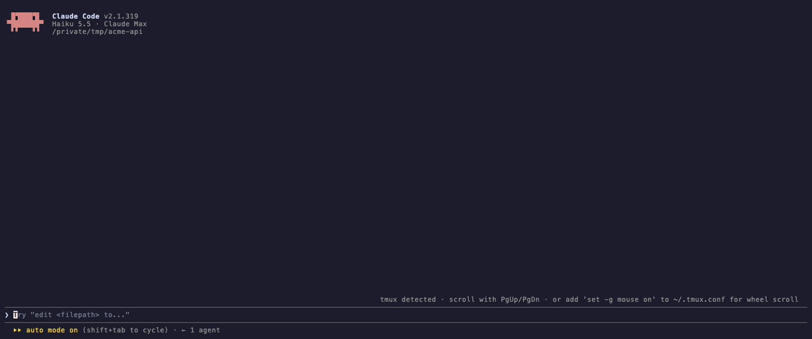
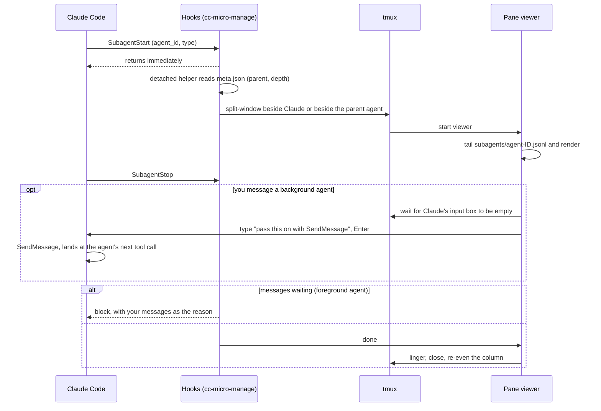

<div align="center">

# cc-micro-manage

**Watch every Claude Code subagent and background shell work, live, in its own tmux or Ghostty pane.**

*For fellow control freaks: hover over your subagents the way your manager micromanages you.<br>(If you still have one.)*

[](https://github.com/debanjan97/cc-micro-manage/actions/workflows/test.yml)
[](LICENSE)
[](https://code.claude.com/docs/en/plugins)
[](https://github.com/tmux/tmux)
[](https://ghostty.org)
[](https://www.python.org/)
[](#requirements)



</div>

When Claude Code fans work out to subagents, all you normally see is a spinner. **cc-micro-manage** gives each subagent its own live pane, in tmux or as a native Ghostty split on macOS, showing its task, text, thinking, tool calls and results as they happen. Panes stack up beside Claude as agents start and close as they finish, and you can type into any of them to steer that agent mid-task. Background shells, like the dev server or test watcher Claude starts and leaves running, get a pane too, streaming their output.

## Contents

- [Features](#features)
- [Requirements](#requirements)
- [Installation](#installation)
- [Quick start](#quick-start)
- [Messaging a subagent](#messaging-a-subagent)
- [Ghostty](#ghostty)
- [Configuration](#configuration)
- [How it works](#how-it-works)
- [Troubleshooting](#troubleshooting)
- [Limitations](#limitations)
- [Contributing](#contributing)
- [License](#license)

## Features

- 🪟 **One live pane per subagent, drawn like Claude Code.** Each pane shows the subagent's task, its messages, its thinking, and every tool call with a short result, using Claude Code's own look: `⏺ Bash(…)` with `⎿` results, a dot that turns green or red when the tool finishes, diffs for edits, checkboxes for todos, and box-drawn tables.
- 🏷️ **Panes named by purpose.** Each pane's border shows what the agent is for, such as `● Scout: describe every .go file`. The dot is yellow while it runs, red after a failed tool call, and green when it finishes.
- 📊 **Footer like Claude Code's.** Each pane shows the model, effort level, context size, output tokens and elapsed time for its agent.
- 📚 **FIFO stack.** Panes stack on the right, oldest on top, while Claude keeps the left 55%. When an agent finishes, its pane closes and the rest move up evenly.
- 🌳 **Nested agents split their parent.** A subagent's own subagents open beside *its* pane, following the same rule at every level, up to Claude Code's depth limit of 5.
- 🐚 **Background shells too.** When Claude (or a subagent) runs a command in the background, such as `npm run dev` or `pytest --watch`, it gets a pane streaming its output as it runs, drawn as a `⏺ Bash(…)` call. The dot turns green or red when the command exits, and the pane closes after it exits, is stopped, or the session ends. A shell a subagent starts opens beside that agent's pane. Ordinary commands stay inline in Claude.
- 💬 **Message box.** Type into any subagent's pane to steer it mid-task. Background agents get it relayed through Claude within seconds (see [Messaging](#messaging-a-subagent)).
- 🧹 **Cleans up after itself.** Panes close when agents finish, when Claude's pane goes away, or after 30 idle minutes.
- 👻 **tmux or Ghostty.** In tmux, panes are tmux panes. Running Claude straight in Ghostty on macOS, they are native Ghostty splits instead, with no tmux needed (see [Ghostty](#ghostty)).
- 🪶 **Lightweight.** One Python file with no dependencies. The hook returns instantly, and outside tmux and Ghostty it does nothing.
- 🔒 **Hands-off.** Your agents run exactly as before, and the plugin never rearranges panes you created yourself. The only time it types anything is when you message a background agent: it puts a one-line request into Claude's input box, and only while that box is empty.

## Requirements

| | |
|---|---|
| **Claude Code** | 2.1.83 or newer (settings show up in `/config` from 2.1.269). Tested with 2.1.319. |
| **Terminal** | **tmux** 3.0 or newer (macOS or Linux), or **Ghostty** 1.3 or newer on macOS. Claude must run inside one of them. |
| **Python** | 3.11 or newer, as `python3` on your `PATH`. On macOS, install it with Homebrew (`brew install python`): the system `/usr/bin/python3` is too old. |
| **OS** | macOS or Linux. |

## Installation

Run these inside Claude Code:

```
/plugin marketplace add debanjan97/cc-micro-manage
/plugin install cc-micro-manage@cc-micro-manage
```

Then restart `claude` **inside a tmux session**, or in a Ghostty window on macOS.

<details>
<summary>Install from a local clone (for development)</summary>

```bash
git clone https://github.com/debanjan97/cc-micro-manage
claude plugin marketplace add ./cc-micro-manage
claude plugin install cc-micro-manage@cc-micro-manage
```

A plugin installed from a local marketplace loads in place, so your edits take effect the next time you start `claude`.
</details>

## Quick start

Open a repo in Claude Code inside tmux or Ghostty and paste:

```
Launch 3 general-purpose subagents in parallel: (1) Scout: read every source file one at a
time and describe each in one line. (2) Lead: launch 2 subagents in parallel, one summarizes
the README, one lists TODO/FIXME comments as file:line; combine their answers. (3) Deps: for
each dependency in the package manifest, find where the code uses it. Then give me a 3-line summary.
```

Three panes stack up on the right. Lead's pane splits to show its two children (marked `↳`). As each agent finishes, its pane says **✻ … finished · worked for 1m 12s** and closes.

To regenerate the GIF above, see [`demo/`](demo/): `./demo/setup-demo-repo.sh && vhs demo/demo.tape`. The GIF itself lives on the [`assets`](https://github.com/debanjan97/cc-micro-manage/tree/assets) branch, which keeps the plugin under the directory's 5 MiB file limit.

## Messaging a subagent

Every pane has a message box on its bottom line. Click the pane (with tmux mouse mode, or in Ghostty) or move to it with `prefix + arrow`, type, and press **Enter**. In tmux you can also press **`prefix + a`** from anywhere in the pane to type into tmux's own prompt.

```
❯ also check the refresh-token path
  ⎿  queued · delivered when it wraps up
─────────────────────────────────────────────────────────────────────
❯ queued · type another, or wait for it to wrap up
─────────────────────────────────────────────────────────────────────
  Haiku 5.5 · medium effort · 41.0k context · 2.3k out · 1m 37s
```

How the message gets there depends on how Claude started the subagent:

| Subagent | How your message reaches it |
|---|---|
| **Background** (the usual case in interactive Claude Code) | **Relayed through Claude.** Once Claude's input box is empty, the plugin types a one-line request into it for you ("pass this on to subagent … with SendMessage"), and Claude forwards it with its own messaging tool. The agent picks it up at its next tool call, usually within seconds, and the pane shows `⎿  received from Claude`. |
| **Foreground** (e.g. `claude -p` runs) | **Delivered when it tries to finish.** The plugin holds the subagent from finishing and passes your message as the reason, so it keeps working and mentions what it did about it. The calling agent is told what you sent, so the extra work isn't mistaken for going off-brief. |

```
✉ you: also check the refresh-token path (relaying via Claude)
✉ handed to Claude (it lands at the agent's next tool call)
✉ received from Claude: also check the refresh-token path
```

> [!NOTE]
> **The relay never touches a draft.** If you've half-typed something in Claude's input box, or a permission dialog or copy mode is open, the relay waits and the pane's status line says `✉ waiting: Claude's input box has a draft`. It sends as soon as the box is clear. The relay shows up in Claude's conversation as a normal message from you, and Claude confirms it in one line. Turn off **Relay messages to background subagents** in [the settings](#configuration) to stop it; background panes are then read-only.

<details>
<summary>Why not inject messages straight into the subagent?</summary>

We tried. Text that appears in the middle of an agent's work claiming "the user says…" looks exactly like a prompt injection, and Claude rightly ignores it. That holds whether it arrives in a tool result, as extra context from a hook, or as the reason a tool call was blocked. The one channel Claude treats as legitimate steering is a hook that holds the agent from finishing and explains why. That channel exists for steering ("keep going until the tests pass"), so cc-micro-manage uses it for foreground agents. Background agents ignore it, but Claude itself can message them, and a request typed into Claude's own input box is genuinely yours, so the relay goes that way.
</details>

Your text goes through a tmux pane option, never through a shell, so quotes, `$(…)` and `#{…}` are all safe.

## Ghostty

On macOS, run `claude` straight in a Ghostty window (no tmux) and subagent panes open as native Ghostty splits, driven by Ghostty's AppleScript support. Everything above works the same way: the column beside Claude, nested agents splitting their parent, the message box, the `window` layout (an `agents` tab instead of a tmux window), and panes closing when their agent finishes. Focus stays in Claude's pane.

A few things differ, because Ghostty doesn't offer them:

- **Background subagents' panes are read-only.** The relay has to see Claude's input box to know it's empty, and Ghostty can't show another program a terminal's screen. Foreground subagents take messages as usual.
- **No border titles or status dots.** Ghostty splits have no borders. Each pane's purpose is its terminal title, which shows in the tab bar while the pane is focused.
- **No `prefix + a` shortcut**, since there's no tmux prefix. Click a pane and type into its message box.
- **Claude keeps half the width**, not 55%: the plugin evens out splits with Ghostty's `equalize_splits`, and only while the tab holds nothing but Claude and its agents.

If Claude runs in tmux *inside* Ghostty, the plugin uses tmux. Setting `macos-applescript = false` in your Ghostty config turns Ghostty support off.

## Configuration

Change settings in Claude Code's **`/config`** panel, where cc-micro-manage's options appear once the plugin is enabled, or under **`/plugin` → cc-micro-manage → Configure**. Restart `claude` to apply them.

| Setting | Default | What it does |
|---|---|---|
| **Pane layout** (`layout`) | `split` | `split`: a column beside Claude, as in the GIF. `window`: tile all subagent panes in a separate `agents` tmux window (a tab, in Ghostty). |
| **Seconds a pane stays after its agent finishes** (`linger`) | `10` | `-1` keeps a finished pane open until you press Enter. |
| **Message shortcut** (`message_shortcut`) | `a` | Key after your tmux prefix that opens the message prompt. `none` disables it. A binding that isn't ours is never overwritten, so pick a free key (tmux already uses `m`, for example). |
| **Relay messages to background subagents** (`relay`) | on | Off makes background panes read-only. See [Messaging](#messaging-a-subagent). |
| **Pane border titles** (`borders`) | on | Turns on pane-border titles in windows with agent panes, only if you haven't enabled borders yourself, and switches them off when the last agent finishes. |
| **Panes for background shells** (`shells`) | on | Off: background shells (Bash commands Claude runs in the background) don't get a pane. |
| **Agent types to ignore** (`skip`) | none | Comma-separated, e.g. `Explore,statusline-setup`. |

From your shell, set them at install time with `claude plugin install cc-micro-manage@cc-micro-manage --config linger=5`, or later with:

```bash
echo '{"linger": "5", "skip": "statusline-setup"}' | claude plugin configure cc-micro-manage@cc-micro-manage --values-stdin
```

<details>
<summary>Environment variables (older setups, per-shell overrides, debugging)</summary>

Each setting also has an environment variable, which wins over the plugin setting: `CC_MICRO_MANAGE_LAYOUT`, `CC_MICRO_MANAGE_LINGER`, `CC_MICRO_MANAGE_SHORTCUT`, `CC_MICRO_MANAGE_RELAY` (`0` = off), `CC_MICRO_MANAGE_BORDERS` (`0` = off), `CC_MICRO_MANAGE_SHELLS` (`0` = off) and `CC_MICRO_MANAGE_SKIP`. Set them in the `env` block of `~/.claude/settings.json` or export them before starting `claude`. Two exist only as variables:

| Variable | What it does |
|---|---|
| `CC_MICRO_MANAGE_OFF` | `1` disables the plugin for that shell without uninstalling it. |
| `CC_MICRO_MANAGE_DEBUG` | `1` logs hook payloads, and the settings the hooks received, to `/tmp/cc-micro-manage-<uid>/debug.jsonl`. |
</details>

## How it works



| Hook | What it does |
|---|---|
| `SubagentStart` | Hands the event to a detached helper, which reads `<session>/subagents/agent-<id>.meta.json` to find the parent agent and opens the pane in the right place. |
| `SubagentStop` | Delivers any messages still waiting, or marks the agent done so its pane can close. |
| `PostToolUse` (`Agent`/`Task`) | Tells the calling agent what you sent its subagent. |
| `PostToolUse` (`Bash`) | For a command run in the background, hands it to a detached helper that opens a pane for it. Ordinary commands are ignored. |
| `SessionEnd` | Closes the panes of the session's background shells, which Claude Code stops with it. |

Each pane runs the plugin's viewer (`cc_micro_manage.py view`). It tails the subagent's transcript, strips Claude Code's internal bookkeeping such as `<system-reminder>` blocks, and keeps the message box pinned to the bottom using a terminal scroll region.

A background shell's pane runs `cc_micro_manage.py shell-view` instead. Claude Code writes the command's output to `/tmp/claude-<uid>/<project>/<session>/tasks/<id>.output` as it runs, and adds `[exited with code N]` or `[killed]` when it ends. The pane tails that file, keeps the output's colours but drops cursor movement and screen clears, and closes on that last line.

## Troubleshooting

<details>
<summary><b>No panes appear</b></summary>

- Is `claude` running **inside tmux**, or in **Ghostty** on macOS? `echo $TMUX` should print something in tmux, and `echo $TERM_PROGRAM` should print `ghostty` in Ghostty.
- In Ghostty: check `osascript -e 'tell application "Ghostty" to get version'` prints 1.3 or newer. If macOS asks whether Ghostty may control Ghostty, allow it.
- Did you restart `claude` after installing? Hooks are loaded at startup.
- Run `/plugin` and check that `cc-micro-manage` is enabled.
- Start `claude` with `CC_MICRO_MANAGE_DEBUG=1`, start a subagent, then check `/tmp/cc-micro-manage-$(id -u)/debug.jsonl`. If it's empty, the hooks aren't firing.
</details>

<details>
<summary><b>A pane says "Couldn't find this subagent's transcript"</b></summary>

Claude Code changed where it stores subagent transcripts. They are undocumented internals; see [Limitations](#limitations). Please [open an issue](https://github.com/debanjan97/cc-micro-manage/issues) with your `claude --version`.
</details>

<details>
<summary><b><code>prefix + a</code> does nothing</b></summary>

Another binding already uses that key, and cc-micro-manage never overwrites bindings it didn't create. Pick a free **Message shortcut** in [the settings](#configuration), or type into the pane's message box directly.
</details>

<details>
<summary><b>"Invalid API key" only inside tmux</b></summary>

Your tmux server may have kept an old `ANTHROPIC_API_KEY`. Check with `tmux show-environment -g ANTHROPIC_API_KEY`, and clear it with `tmux set-environment -gu ANTHROPIC_API_KEY`. This isn't caused by the plugin, but it's easy to hit when you first run Claude in tmux.
</details>

## Limitations

- **It relies on undocumented internals.** The hook events are documented. The transcript files (`subagents/agent-<id>.jsonl`) and the parent links (`agent-<id>.meta.json`) are not, and a Claude Code release could change them. Parsing is defensive: the worst case is a pane that can't find its transcript.
- **Relayed messages go through Claude's conversation.** Each one adds a short turn (your relay request and Claude's one-line confirmation) to the main session. The relay reads Claude's input box from the screen, so a big Claude Code UI change could stop it detecting an empty box; it then just waits, and never types over anything.
- **It's a view, not a terminal.** You can't type commands into a subagent, or input into a background shell. Panes show what the agent or command does.
- **Shell output arrives a line at a time.** A prompt or progress text with no newline after it shows once a newline follows. Background shell output is also undocumented (`tasks/<id>.output`); if Claude Code moves it, the pane says it couldn't find the output.
- **It needs tmux, or Ghostty on macOS.** Ghostty on Linux has no scripting interface yet, and there's no iTerm2, WezTerm or Zellij support. PRs are welcome.

## Contributing

Issues and PRs are welcome; see [CONTRIBUTING.md](CONTRIBUTING.md). Changes are tracked in [CHANGELOG.md](CHANGELOG.md).

## License

[MIT](LICENSE) © Debanjan Ganguly
