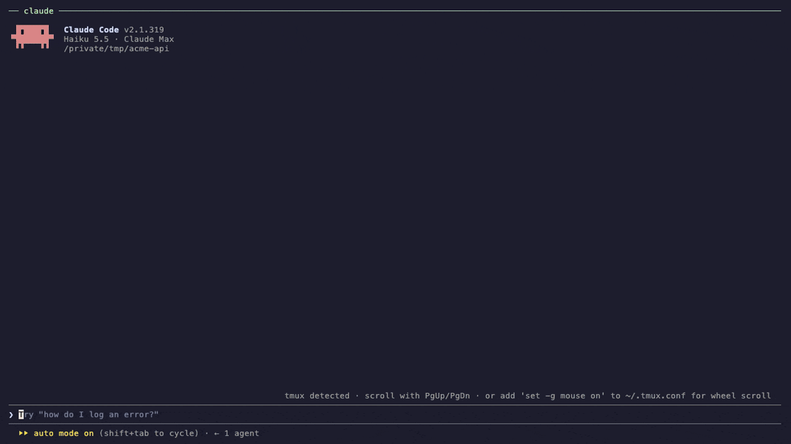
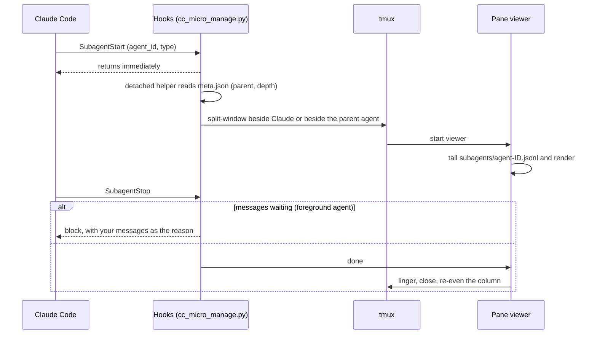

<div align="center">

# cc-micro-manage

**Watch every Claude Code subagent work, live, in its own tmux pane.**

[](LICENSE)
[](https://code.claude.com/docs/en/plugins)
[](https://github.com/tmux/tmux)
[](https://www.python.org/)
[](#requirements)



</div>

When Claude Code fans work out to subagents, all you normally see is a spinner. **cc-micro-manage** gives each subagent its own live tmux pane, showing its task, text, thinking, tool calls and results as they happen. Panes stack up beside Claude as agents start and close as they finish.

## Contents

- [Features](#features)
- [Requirements](#requirements)
- [Installation](#installation)
- [Quick start](#quick-start)
- [Messaging a subagent](#messaging-a-subagent)
- [Configuration](#configuration)
- [How it works](#how-it-works)
- [Troubleshooting](#troubleshooting)
- [Limitations](#limitations)
- [Contributing](#contributing)
- [License](#license)

## Features

- 🪟 **One live pane per subagent.** Each pane shows the subagent's task, its messages, its thinking, and every tool call with a short result.
- 📊 **Footer like Claude Code's.** Each pane shows the model, effort level, context size, output tokens and elapsed time for its agent.
- 📚 **FIFO stack.** Panes stack on the right, oldest on top, while Claude keeps the left 55%. When an agent finishes, its pane closes and the rest move up evenly.
- 🌳 **Nested agents split their parent.** A subagent's own subagents open beside *its* pane, following the same rule at every level, up to Claude Code's depth limit of 5.
- 💬 **Message box.** Type into a foreground subagent's pane to steer it before it finishes (see [Messaging](#messaging-a-subagent)).
- 🧹 **Cleans up after itself.** Panes close when agents finish, when Claude's pane goes away, or after 30 idle minutes.
- 🪶 **Lightweight.** One Python file with no dependencies. The hook returns instantly, and outside tmux it does nothing.
- 🔒 **Read-only views.** Your agents run exactly as before, and the plugin never rearranges panes you created yourself.

## Requirements

| | |
|---|---|
| **Claude Code** | Recent version with plugin support. Tested with 2.1.319. |
| **tmux** | 3.0 or newer, and Claude must run inside it. |
| **Python** | 3.9 or newer, as `python3` on your `PATH`. |
| **OS** | macOS or Linux. |

## Installation

Run these inside Claude Code:

```
/plugin marketplace add debanjan97/cc-micro-manage
/plugin install cc-micro-manage@cc-micro-manage
```

Then restart `claude` **inside a tmux session**.

<details>
<summary>Install from a local clone (for development)</summary>

```bash
git clone https://github.com/debanjan97/cc-micro-manage
claude plugin marketplace add ./cc-micro-manage
claude plugin install cc-micro-manage@cc-micro-manage
```

A plugin installed from a local marketplace loads in place, so your edits take effect the next time you start `claude`.
</details>

## Quick start

Open a repo in Claude Code inside tmux and paste:

```
Launch 3 general-purpose subagents in parallel: (1) Scout: read every source file one at a
time and describe each in one line. (2) Lead: launch 2 subagents in parallel, one summarizes
the README, one lists TODO/FIXME comments as file:line; combine their answers. (3) Deps: for
each dependency in the package manifest, find where the code uses it. Then give me a 3-line summary.
```

Three panes stack up on the right. Lead's pane splits to show its two children (marked `↳`). As each agent finishes, its pane says **✓ finished** and closes.

To regenerate the GIF above, see [`demo/`](demo/): `./demo/setup-demo-repo.sh && vhs demo/demo.tape`.

## Messaging a subagent

Every pane has a message box on its bottom line. Click the pane (with tmux mouse mode) or move to it with `prefix + arrow`, type, and press **Enter**. You can also press **`prefix + a`** from anywhere in the pane to type into tmux's own prompt.

```
✉ you: also check the refresh-token path (queued — delivered when it wraps up)
─ ✉ queued · type another, or wait for it to wrap up ───────────────
✉ › |
```

The message is **delivered when the subagent tries to finish**. The plugin holds the subagent from finishing and passes your message as the reason, so it keeps working, then mentions in its final reply what it did about your message. The calling agent is also told what you sent, so it doesn't mistake the extra work for the subagent going off-brief.

> [!IMPORTANT]
> **Messaging only works for foreground subagents.** Interactive Claude Code usually runs subagents in the **background**. A background subagent hands its report back before it stops, so there's no point at which it can still be steered. Those panes show `read-only · background subagent`. Messaging works when Claude runs subagents in the foreground, for example in `claude -p` (headless) runs.

<details>
<summary>Why not deliver messages instantly, mid-task?</summary>

We tried. Text that appears in the middle of an agent's work claiming "the user says…" looks exactly like a prompt injection, and Claude rightly ignores it. That holds whether it arrives in a tool result, as extra context from a hook, or as the reason a tool call was blocked. The one channel Claude treats as legitimate steering is a hook that holds the agent from finishing and explains why. That channel exists for steering ("keep going until the tests pass"), so cc-micro-manage uses it.
</details>

Your text goes through a tmux pane option, never through a shell, so quotes, `$(…)` and `#{…}` are all safe.

## Configuration

Set these in the `env` block of `~/.claude/settings.json`, or export them before starting `claude`:

| Variable | Default | Description |
|---|---|---|
| `CC_MICRO_MANAGE_LAYOUT` | `split` | `split`: a column beside Claude, as in the GIF. `window`: tile all subagent panes in a separate `agents` tmux window. |
| `CC_MICRO_MANAGE_LINGER` | `10` | Seconds a pane stays open after its agent finishes. `-1` keeps it open until you press Enter. |
| `CC_MICRO_MANAGE_KEY` | `a` | Key after your tmux prefix that opens the message prompt. `none` disables it. An existing binding that isn't ours is never overwritten. |
| `CC_MICRO_MANAGE_SKIP` | none | Comma-separated agent types to ignore, e.g. `Explore,statusline-setup` |
| `CC_MICRO_MANAGE_OFF` | none | `1` disables the plugin without uninstalling it. |
| `CC_MICRO_MANAGE_DEBUG` | none | `1` logs hook payloads to `/tmp/cc-micro-manage-<uid>/debug.jsonl`. |

```json
{
  "env": {
    "CC_MICRO_MANAGE_LINGER": "5",
    "CC_MICRO_MANAGE_SKIP": "statusline-setup"
  }
}
```

## How it works



| Hook | What it does |
|---|---|
| `SubagentStart` | Hands the event to a detached helper, which reads `<session>/subagents/agent-<id>.meta.json` to find the parent agent and opens the pane in the right place. |
| `SubagentStop` | Delivers any messages still waiting, or marks the agent done so its pane can close. |
| `PostToolUse` (`Agent`/`Task`) | Tells the calling agent what you sent its subagent. |

Each pane runs `cc_micro_manage.py view`. It tails the subagent's transcript, strips Claude Code's internal bookkeeping such as `<system-reminder>` blocks, and keeps the message box pinned to the bottom using a terminal scroll region.

## Troubleshooting

<details>
<summary><b>No panes appear</b></summary>

- Is `claude` running **inside tmux**? Check that `echo $TMUX` prints something.
- Did you restart `claude` after installing? Hooks are loaded at startup.
- Run `/plugin` and check that `cc-micro-manage` is enabled.
- Set `CC_MICRO_MANAGE_DEBUG=1`, start a subagent, then check `/tmp/cc-micro-manage-$(id -u)/debug.jsonl`. If it's empty, the hooks aren't firing.
</details>

<details>
<summary><b>A pane says "Couldn't find this subagent's transcript"</b></summary>

Claude Code changed where it stores subagent transcripts. They are undocumented internals; see [Limitations](#limitations). Please [open an issue](https://github.com/debanjan97/cc-micro-manage/issues) with your `claude --version`.
</details>

<details>
<summary><b><code>prefix + a</code> does nothing</b></summary>

Another binding already uses that key, and cc-micro-manage never overwrites bindings it didn't create. Pick a free key with `CC_MICRO_MANAGE_KEY`, or type into the pane's message box directly.
</details>

<details>
<summary><b>"Invalid API key" only inside tmux</b></summary>

Your tmux server may have kept an old `ANTHROPIC_API_KEY`. Check with `tmux show-environment -g ANTHROPIC_API_KEY`, and clear it with `tmux set-environment -gu ANTHROPIC_API_KEY`. This isn't caused by the plugin, but it's easy to hit when you first run Claude in tmux.
</details>

## Limitations

- **It relies on undocumented internals.** The hook events are documented. The transcript files (`subagents/agent-<id>.jsonl`) and the parent links (`agent-<id>.meta.json`) are not, and a Claude Code release could change them. Parsing is defensive: the worst case is a pane that can't find its transcript.
- **Messaging is foreground-only.** See [above](#messaging-a-subagent).
- **It's a view, not a terminal.** You can't type commands into a subagent. Panes show what the agent does.
- **It needs tmux.** There's no iTerm2, WezTerm or Zellij support yet. PRs are welcome.

## Contributing

Issues and PRs are welcome; see [CONTRIBUTING.md](CONTRIBUTING.md). Changes are tracked in [CHANGELOG.md](CHANGELOG.md).

## License

[MIT](LICENSE) © Debanjan Ganguly
